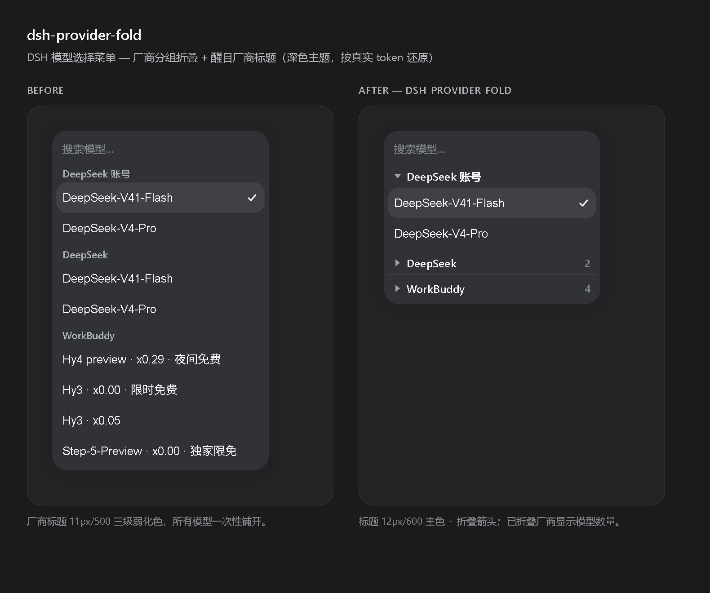

# dsh-provider-fold

为 **DSH（DeepSeek Harness）** 模型选择菜单提供「厂商分组可折叠 + 厂商标题更醒目」。

接入多个厂商后，模型选择列表会变成一条很长的滚动列表。这个插件把每个厂商标题变成可点击的折叠行，并把标题样式做明显，让你可以把手头不用的厂商收起来。



## 功能

- **厂商分组可折叠** —— 点击厂商标题（或聚焦后按 <kbd>Enter</kbd> / <kbd>Space</kbd>）即可收起该厂商的模型。
- **厂商标题更醒目** —— 标题由原来的 11px/500 三级弱化文字，升级为 12px/600 一级主色 + 折叠箭头，扫一眼就能分清厂商。
- **模型数量角标** —— 收起后的厂商会显示它隐藏了多少个模型。
- **记住你的选择** —— 折叠状态存在 `localStorage`，下次打开菜单自动恢复。
- **搜索优先** —— 在搜索框输入时自动全部展开，匹配结果不会被藏起来；你保存的折叠选择不受影响，清空搜索后原样恢复。
- **键盘友好** —— 键盘高亮移到已折叠的厂商时，会临时展开它（仅本次交互），不会覆盖你保存的状态。
- **作用域收敛、防御式实现** —— 只装饰模型菜单（`role="menu"` + `-models` 容器），其它用同一套 primitives 构建的菜单一律不动；宿主标记结构若变化，插件静默不动作，不会把菜单改坏。
- **不移除布局节点** —— 折叠用 `display: none` 隐藏模型行、节点仍留在 DOM 中，因此不会打乱宿主组件自身的键盘索引。

## 安装

```bash
dsh plugin --profile web add dsh-provider-fold
```

把 `web` 换成你使用的 profile（桌面端通常是 `desktop`）：

```bash
dsh plugin --profile desktop add dsh-provider-fold
```

安装后刷新一次页面即可。本插件是 `immediately: true` 的客户端 bundle，会随应用外壳一起挂载。

卸载：

```bash
dsh plugin --profile desktop remove dsh-provider-fold
```

## 使用

1. 在输入区打开模型菜单（模型 chip）。
2. 每个厂商名现在都是一个带折叠箭头的标题行。
3. 点击标题，或聚焦后按 <kbd>Enter</kbd> / <kbd>Space</kbd>，收起 / 展开该厂商。
4. 收起后的厂商会显示一个小的模型数量。

## 兼容性

- DSH 客户端 `0.2.0-rc.2` 及以上。
- 仅支持 `platform: "web"`（桌面端使用的就是 web 界面）。
- 只依赖宿主 UI 已公开的稳定钩子：primitives `MenuGroup` 上的 `data-menu-group` / `data-menu-group-heading`，以及 DSH 主题变量（`--dsw-alias-label-primary`、`--dsw-alias-label-caption`、`--dsw-alias-interactive-bg-hover`、`--dsw-alias-border-l2`、`--dsw-focus-ring-color`）。
- 不注册宿主服务、不访问网络、不上报任何数据。唯一持久化的是 `localStorage` 中键为 `dsh-provider-fold:collapsed` 的已折叠厂商名列表。

## 权限

| 资源 | 用途 |
| --- | --- |
| `localStorage` | 记录你折叠了哪些厂商。 |
| DOM（读 / 写） | 装饰模型菜单、切换模型行的 `display`。 |

除此之外不触碰任何东西。

## 实现说明

插件包含客户端与宿主两半：

- `client.js` —— DSH 客户端模块。在 `apply(ctx)` 内注册唯一的 `ctx.effect`，注入一个 `<style data-plugin="dsh-provider-fold">`，安装 `MutationObserver` 以及委托的 `click` / `keydown` / `input` / `focusin` 监听，并返回清理函数。宿主的 client-modules 运行时会在重载或卸载时自动回收该 style 元素。
- `index.js` —— 空的宿主半（`export function apply() {}`），只为让 bundle 有可解析的入口。
- `cordis.patch.yml` —— 把该 bundle 插入 profile 组合。

## 开发

仓库根目录**就是**插件包本体。要对着正在运行的 DSH 调试：

```bash
dsh plugin --profile desktop add /absolute/path/to/dsh-provider-fold
```

这样会以 link 方式安装，之后对 `client.js` 的改动会在约半秒内被宿主的 client HMR 监视器捕获并热重载 —— 无需重启宿主，也无需刷新页面。

运行无头 DOM 测试（jsdom），覆盖装饰、折叠、持久化、搜索交互、键盘展开与清理：

```bash
npm install
npm test
```

## 许可证

MIT，见 [LICENSE](./LICENSE)。
